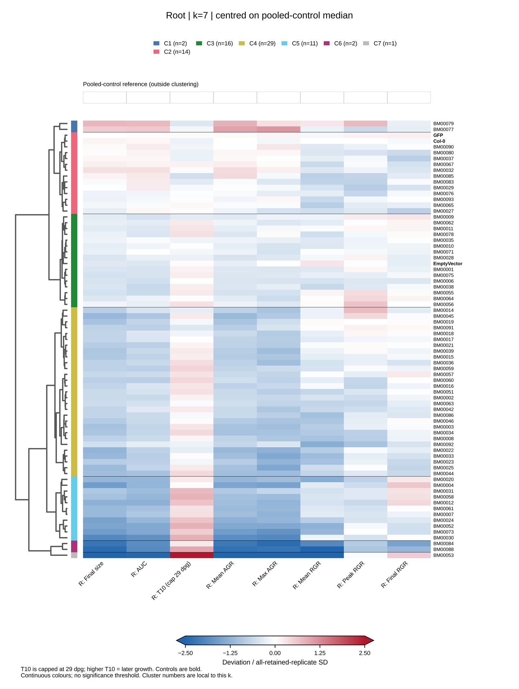
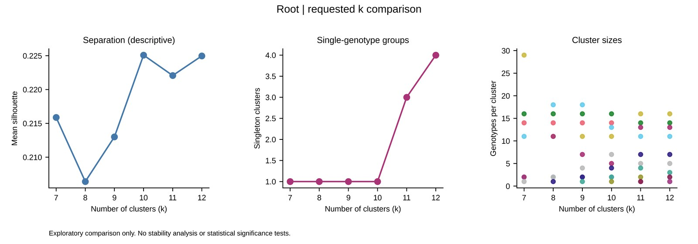
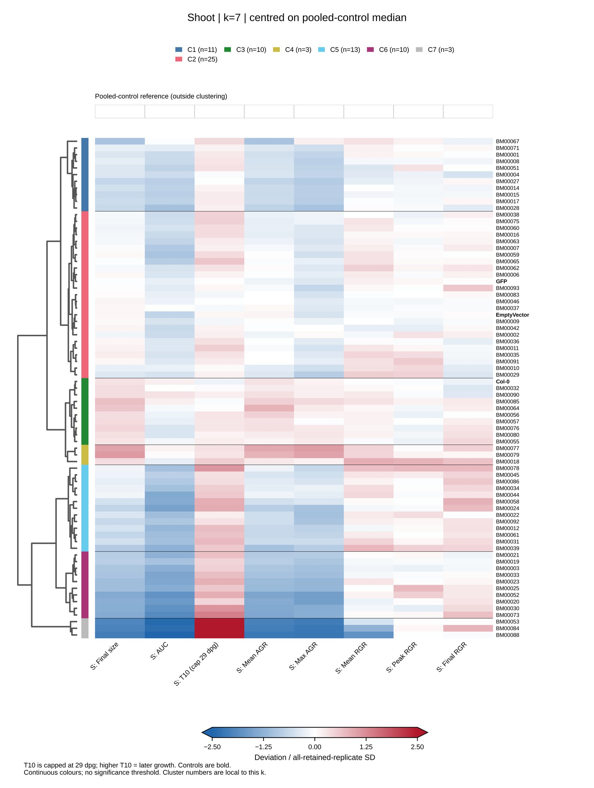
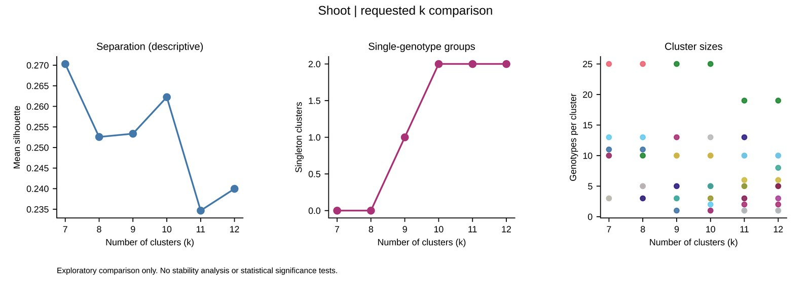
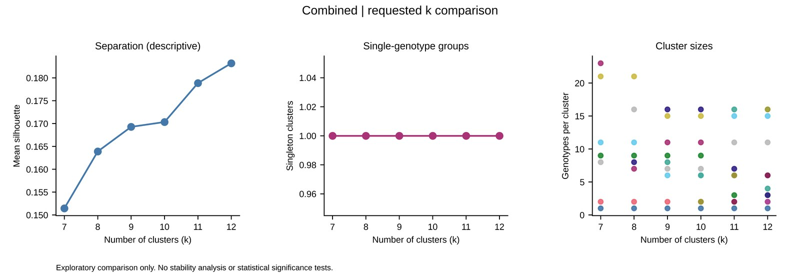

# Final root and shoot phenotype clustering

This directory contains the final-sheet analysis of BM-effector phenotypes in root and shoot tissues. The root, shoot and combined profiles were clustered independently using newly calculated Ward hierarchies and compared at k = 7, 8, 9, 10, 11 and 12.

The k=7 images below are examples for web display. They are not presented as an optimal cluster number. Results for every requested k are available as PDFs under `figures/`.

## Root example: k=7, control-centred colours





## Shoot example: k=7, control-centred colours





## Combined example: k=7, control-centred colours




## Analysis design

Eight traits were analysed per tissue:

1. Final size (`area_end_mm2`)
2. Area under the curve (`AUC`)
3. Time to 10 mm², capped at day 29
4. Mean absolute growth rate (`AGR_mean`)
5. Maximum absolute growth rate (`AGR_max`)
6. Mean relative growth rate (`RGR_mean`)
7. Peak relative growth rate (`RGR_peak`)
8. Final relative growth rate (`RGR_final`)

The combined analysis concatenates the eight root and eight shoot traits. Root and shoot measurements are not averaged. Biological pairing between tissues was not assumed.

Each genotype is represented by the median of its retained replicate measurements. Trait reference means and population standard deviations (`ddof=0`) were calculated from all available retained individual measurements, including controls.

## Exclusions and incomplete traits

Records marked `included=False` in a final input sheet were excluded from that tissue. An additional identifier-level rule excluded a replicate from both analyses when `area_end_mm2` was exactly zero in both root and shoot for the same effector and replicate identifier. A zero in one tissue alone, a near-zero non-zero value, or a zero in another trait did not trigger this rule.

This additional rule removed 65 identifiers. Forty of the excluded shoot records had non-zero AUC, so the exclusion must be described as a joint final-size-zero rule rather than a universal no-growth rule. The full list is available in:

- `reports/additional_joint_zero_exclusions.txt`
- `reports/additional_joint_zero_exclusions.csv`

Blank `time_to_10mm2` values on included records were confirmed to mean that 10 mm² was not reached during observation. The approved timing variable therefore caps recorded or censored values at day 29. A value of 29 means day 29 or later, not an exact crossing on day 29. The supplied day-8 left-censored upper bound for root BM00092 replicate 1 was retained and flagged.

Other missing traits were not replaced with zero. Genotype medians and all-replicate reference statistics used available values for each trait. Trait-specific contributing replicate counts are provided in `tables/<scope>/counts.csv`. BM00029 has one retained replicate per tissue and BM00018 has two; their placement should be interpreted cautiously.

## Two heatmap colour references

Every cluster solution has two heatmap views with the same tree, order and assignments.

`global`

:   `(genotype median - mean of all retained individual measurements) / all-replicate SD`

`control`

:   `(genotype median - pooled-control median) / all-replicate SD`

The pooled control combines retained Col-0, EmptyVector and GFP measurements at the replicate level. Individual control rows retain their measured values and are not forced to zero. The narrow pooled-control strip is outside the dendrogram and does not influence clustering. It is exactly zero in the control-centred view.

Changing the reference point shifts an entire trait column by a constant. It therefore does not change Euclidean distances, the Ward tree or PCA coordinates when the denominator is unchanged.

## Clustering and PCA

The analysis uses Euclidean distance with Ward linkage and optimal leaf ordering. Each newly calculated tree is cut at k = 7 through k = 12. Cluster numbers are local to each cut and are assigned in dendrogram order.

PCA is a two-dimensional visual summary of the same scaled genotype matrix. It is not the clustering method. Silhouette, Calinski-Harabasz and Davies-Bouldin scores, cluster sizes and singleton counts are descriptive comparisons only. No optimal k is claimed. Stability, trait-correlation and leave-one-trait-out sensitivity analyses were not performed.

## Directory guide

- `data/`: public-safe final root and shoot input tables
- `scripts/run_final_clustering.py`: complete analysis and figure pipeline
- `scripts/verify_final_outputs.py`: independent full-output numerical and rendered-figure verifier
- `scripts/verify_repository_snapshot.py`: committed-snapshot verifier
- `tests/`: synthetic regression tests
- `tables/root/`, `tables/shoot/`, `tables/combined/`: medians, counts, scaled matrices, linkage, cluster assignments and PCA source data
- `figures/<scope>/k7/` to `k12/`: all PDF heatmaps and PCA plots
- `figures/previews/`: JPEGs embedded in this README
- `reports/METHODS.md`: full methods
- `reports/RESULTS_SUMMARY.txt`: run-specific counts and limitations
- `reports/QC_SUMMARY.json`: machine-readable QC
- `reports/REPOSITORY_MANIFEST.json`: checksums for the committed snapshot

## Reproduce the full four-format analysis

From `03.final_combined/`:

```bash
python scripts/run_final_clustering.py --dpi 900 --overwrite
python scripts/verify_final_outputs.py
```

This regenerates PDF, JPEG, SVG and TIFF output. Normal Git tracks all PDFs and the six web-preview JPEGs. The bulk raster and SVG files are intentionally omitted from Git history and can be regenerated from the scripts and final inputs.

Run regression tests with:

```bash
python -m pytest tests/test_final_clustering.py -q
```

Verify the committed snapshot with:

```bash
python scripts/verify_repository_snapshot.py
```

## Provenance

The final analysis used only the two tables in `data/`; no previous z-score matrix, cluster assignment or linkage matrix was imported. Workstation-specific source paths were replaced by portable logical identifiers in this public snapshot. Numerical phenotype and QC values were not altered during that sanitisation.

The earlier pooled-control v3 analysis is retained in `../02.v3_pooled_control_heatmaps/` as a historical snapshot.
