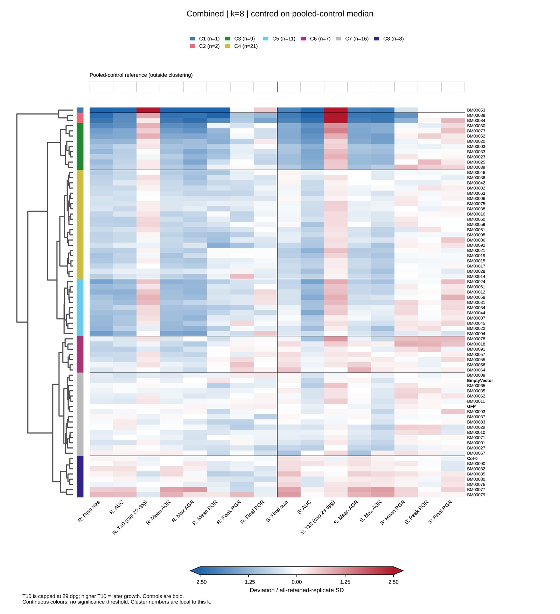

# H. schachtii BM-effector phenotype clustering

This project compares BM-effector infection phenotypes in root and shoot tissues. The current analysis uses the finalised replicate sheets, recalculates every hierarchy from scratch and compares k = 7 through k = 12 for root, shoot and the combined 16-trait profile.

## Final analysis

The complete portable snapshot is in [`03.final_combined/`](03.final_combined/).



The displayed k=8 solution is an example, not a selected optimum. All requested cluster cuts and both colour references are available as PDFs.

### What changed from v3

- Final root and shoot phenotype sheets replaced the earlier summary inputs.
- Records already excluded in the final sheets remain excluded.
- A further 65 identifiers were removed because final size was exactly zero in both tissues.
- Forty of those 65 had non-zero shoot AUC; this is a joint final-size-zero rule, not a universal no-growth rule.
- Blank threshold times on included records are encoded using the approved day-29 cap.
- Reference means and standard deviations are calculated from retained individual measurements, not genotype medians.
- Root, shoot and combined Ward trees are recalculated from the final data.
- Cluster cuts k=7–12 are compared.
- PCA is supplied as a visual projection, not as the clustering method.

### Heatmap views

Each cluster solution has two views with the same dendrogram and assignments:

- `global`: centred on the mean of all retained individual measurements.
- `control`: centred on the median of pooled retained Col-0, EmptyVector and GFP measurements.

Both views divide by the same all-replicate standard deviation. Individual controls are not forced to zero. The separate pooled-control strip is outside clustering and appears at exactly zero in the control-centred view.

### Start here

- [Final analysis README](03.final_combined/README.md)
- [Methods](03.final_combined/reports/METHODS.md)
- [Results and limitations](03.final_combined/reports/RESULTS_SUMMARY.txt)
- [Additional joint-zero exclusions](03.final_combined/reports/additional_joint_zero_exclusions.txt)
- [Root figures](03.final_combined/figures/root/)
- [Shoot figures](03.final_combined/figures/shoot/)
- [Combined figures](03.final_combined/figures/combined/)

## Historical snapshots

`01.clustering_analysis/`

:   Earlier root-only clustering and selected source tables.

`02.v3_pooled_control_heatmaps/`

:   Earlier pooled-control recolouring of the original root, shoot and combined trees. This is preserved for provenance but is not the final-sheet analysis.

## Reproduce

```bash
cd 10.Hschachtii_PhenotypeCluster/03.final_combined
python scripts/run_final_clustering.py --dpi 900 --overwrite
python scripts/verify_final_outputs.py
```

The Git snapshot includes all PDF figures and six JPEG web previews. Full-resolution JPEG, SVG and TIFF files can be regenerated locally and are intentionally omitted from normal Git history.

## Related projects

- `07.Hschachtii_TPM`: H. schachtii bulk TPM analysis
- `11.Hglycines_clustering`: H. glycines expression clustering
