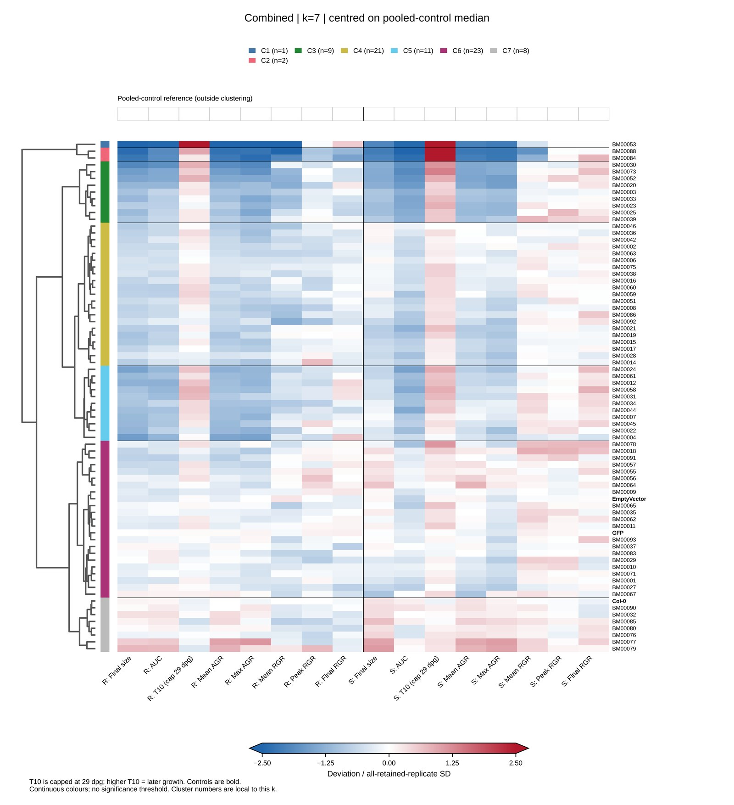

# ProjectPotpourri

Collection of small research projects.

## H. schachtii BM-effector phenotype clustering

The final root-shoot phenotype analysis uses the finalised replicate sheets, recalculates Euclidean-Ward hierarchies and compares k = 7 through k = 12. Heatmaps are provided relative to all retained individual measurements and relative to the pooled Col-0, EmptyVector and GFP controls.

Full analysis, methods, source tables and PDFs: [`10.Hschachtii_PhenotypeCluster/03.final_combined/`](10.Hschachtii_PhenotypeCluster/03.final_combined/)

The displayed k=7 heatmap is illustrative; the repository contains all requested k=7–12 comparisons. The earlier pooled-control v3 snapshot remains available for provenance.

## Projects

- [`01.Bursaphelenchus_RNAseq`](01.Bursaphelenchus_RNAseq) — B. xylophilus stage-specific transcriptome
- [`10.Hschachtii_PhenotypeCluster`](10.Hschachtii_PhenotypeCluster/) — final root-shoot BM-effector phenotype clustering
- [`11.Hglycines_clustering`](11.Hglycines_clustering/) — H. glycines gene-centred VST clustering
- [`12.Pho2RNAseq`](12.Pho2RNAseq/) — rice AM × PHO2 root RNA-seq (ENA PRJEB125245)
